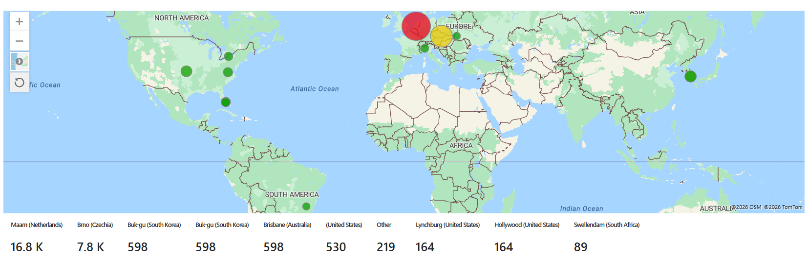
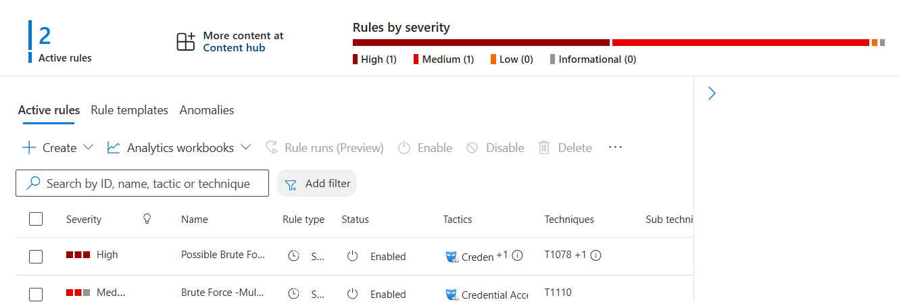
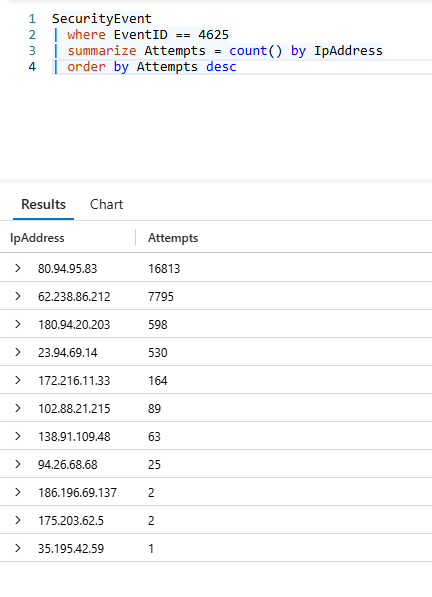
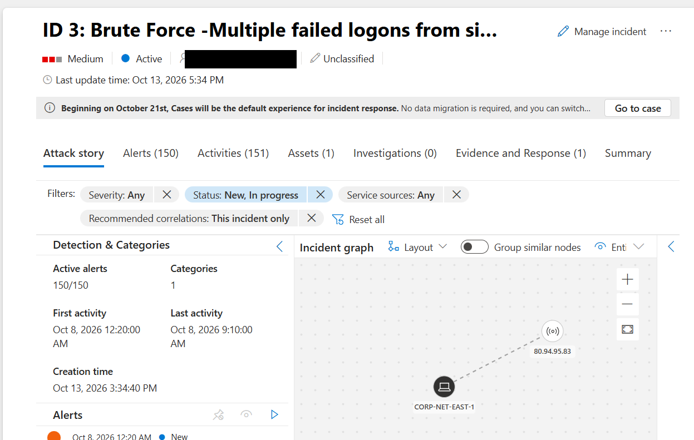
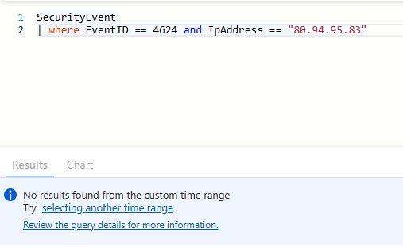
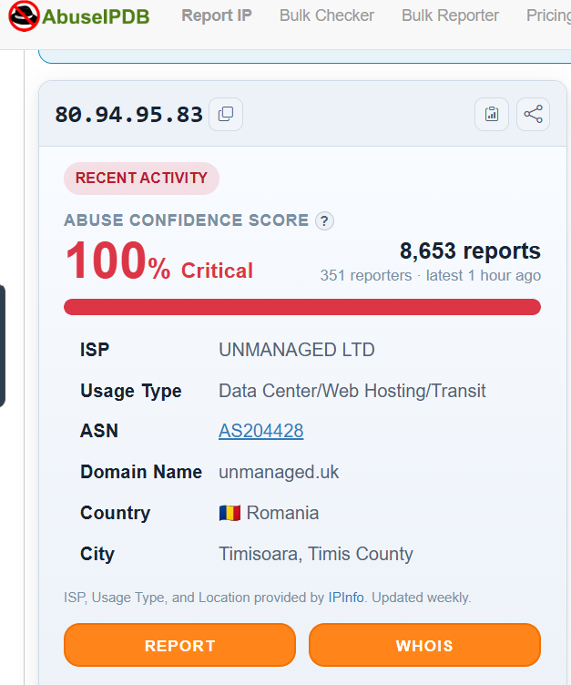
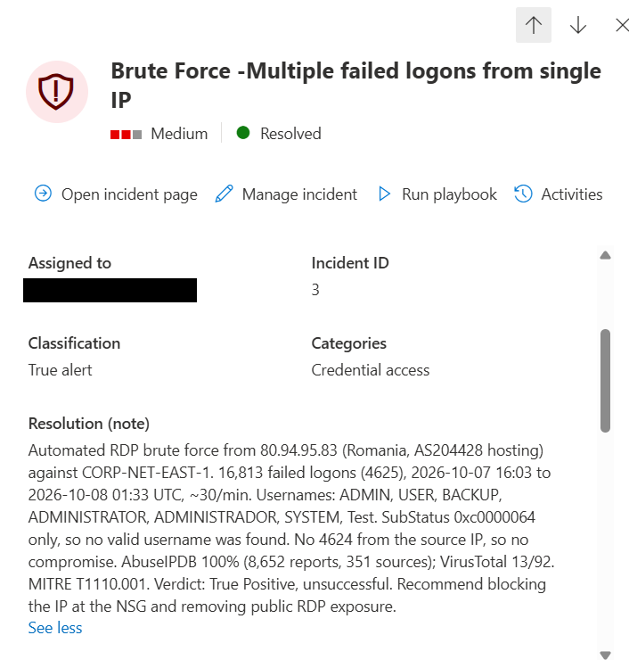

# Azure SOC Honeypot Lab: Microsoft Sentinel, KQL & Incident Response

A cloud honeypot built in Microsoft Azure to attract real-world attacks, collect Windows Security logs into **Microsoft Sentinel**, detect brute-force activity with **custom analytics rules**, and triage the resulting incidents like an L1 SOC analyst.

> Base lab built following Josh Madakor's Azure SOC tutorial. Detection rules, incident triage, threat intelligence enrichment, MITRE mapping and the incident report are my own extensions.



---

## Results at a Glance

| Metric | Value |
|---|---|
| Collection window | ~24 hours (7–8 Oct 2026) |
| Failed logon attempts (Event ID 4625) | **25,960** |
| Unique attacking IPs | **11** |
| Top attacker | 80.94.95.83 (16,813 attempts, ~65% of all traffic) |
| Peak attack rate | 304 attempts in 10 minutes (62.238.86.212) |
| Successful attacker logons (Event ID 4624) | **0** (no compromise) |
| Incidents generated / triaged | 7 / 7 |

---

## Architecture

```
Internet attackers
      │  RDP / SMB / NTLM logon attempts
      ▼
Network Security Group (allow all inbound - intentionally exposed)
      │
      ▼
Windows 10 VM "CORP-NET-EAST-1" (firewall disabled)
      │  Windows Security events
      ▼
Azure Monitor Agent + Data Collection Rule
      │
      ▼
Log Analytics Workspace  ──►  Microsoft Sentinel
                                ├─ KQL hunting queries
                                ├─ GeoIP watchlist enrichment
                                ├─ Workbook attack map
                                └─ Analytics rules → Incidents → Triage
```

**Azure resources:** Resource group `RG-SOC_Lab`, VM `Standard_D2s_v4` (Windows 10 Enterprise), Log Analytics workspace, Microsoft Sentinel, region **East US 2**.

---

## What I Built

1. **Honeypot VM:** Windows 10 VM in Azure, exposed by an allow-all NSG rule with the Windows Firewall turned off, to invite real attacks.
2. **Log pipeline:** Windows Security events sent to a Log Analytics workspace through the Azure Monitor Agent and a Data Collection Rule.
3. **SIEM:** Microsoft Sentinel connected to the workspace.
4. **Enrichment:** GeoIP watchlist joined to failed-logon events to geolocate attackers.
5. **Visualization:** Sentinel workbook showing attack origins on a world map.
6. **Detection engineering:** two custom scheduled analytics rules mapped to MITRE ATT&CK.
7. **Incident response:** triaged the generated incidents, enriched with threat intelligence, and wrote a formal incident report.

---

## Detection Rules

| Rule | Logic | MITRE | Severity | Result |
|---|---|---|---|---|
| **A: Brute Force from Single IP** | ≥10 failed logons (4625) from one IP within 10 minutes | T1110 | Medium | 7 incidents from 6 attacker IPs |
| **B: Logon After Repeated Failures** | Successful logon (4624) from an IP with ≥10 prior failures | T1110, T1078 | High | 0 results (no attacker got in) |

All queries are in [`kql/queries.kql`](kql/queries.kql).



**Top attacking IPs (KQL):**



---

## Incident Investigation (IR-001)

**Incident:** Sentinel Incident #3. RDP brute force from **80.94.95.83**, spanning 53 ten-minute alert windows.

| Triage step | Finding |
|---|---|
| **Scope** | 16,813 failed logons over ~9.5 hours (~30/min), so an automated tool |
| **Usernames tried** | ADMIN, USER, BACKUP, ADMINISTRATOR, ADMINISTRADOR, SYSTEM, Test (generic wordlist) |
| **SubStatus** | `0xc0000064` only, so no valid username was ever found |
| **Impact** | No Event ID 4624 from the IP, so no compromise |
| **Threat intel** | AbuseIPDB 100% confidence (8,652 reports from 351 sources, active since 2023); VirusTotal 13/92; GreyNoise: Malicious |
| **Infrastructure** | Data-center hosting, AS204428, Romania |
| **MITRE** | T1110.001 Brute Force: Password Guessing |
| **Verdict** | **True Positive, unsuccessful.** Opportunistic mass RDP scanning campaign |

Full report: [`incident-reports/IR-001_RDP_Brute_Force_80.94.95.83.md`](incident-reports/IR-001_RDP_Brute_Force_80.94.95.83.md)



**Impact check: no successful logon from the attacker:**



**Threat intelligence (AbuseIPDB):**



**Incident resolved with classification and analyst notes:**



---

## Key Findings

- **Exposed RDP is attacked within hours.** The first attacks arrived soon after exposure; ~26k attempts followed in a day.
- **Attackers use generic wordlists.** Every attempt from the top attacker targeted default account names that didn't exist on the host.
- **Detection gap identified.** 5 of the 11 source IPs never exceeded the 10-in-10-minutes threshold (peaks of 1–4 attempts), so threshold-only rules miss low-and-slow attackers.
- **Rule tuning matters.** Running the rule with a 14-day lookback (to catch historical data) made each hourly run re-alert on the same activity. Incident #3 grew from 53 to 150 alerts until the lookback was reduced. Lookback and frequency must line up to avoid duplicate alerts.
- **Geolocation sources disagree.** The GeoIP watchlist placed 80.94.95.83 in the Netherlands, while AbuseIPDB/IPInfo placed it in Romania. IP geolocation is approximate and should never be the only basis for attribution.
- **Threat intel needs multiple sources.** VirusTotal alone (13/92) understated the risk; AbuseIPDB history, GreyNoise and my own log evidence together confirmed malicious intent.

---

## Recommendations (if this were production)

1. Never expose RDP (3389) directly to the internet. Use Azure Bastion, a VPN or Just-In-Time VM access.
2. Block known-malicious IPs/ASNs at the NSG or firewall.
3. Enforce account lockout, strong passwords and MFA; rename or disable default accounts.
4. Layer detections: short-window and long-window brute-force rules.

---

## Next Steps

- [ ] Add a 24-hour low-and-slow rule (≥30 failures/day) to close the detection gap
- [ ] Automate enrichment with a Logic Apps playbook (IP reputation lookup + incident comment)
- [ ] Harden the NSG and compare attack volume before and after
- [ ] Onboard the VM to Microsoft Defender for Endpoint and investigate simulated attacks (Atomic Red Team)

---

## What I Learned

- **How fast exposed services get attacked.** Within the first ~8 hours the VM had almost 7,000 failed logons; by the next morning it was nearly 26,000. Internet-facing RDP is found and attacked by automated bots almost immediately.
- **Reading Windows logon events properly.** Event ID 4625 shows a failed logon, but the **SubStatus** code says why. `0xc0000064` (user doesn't exist) and `0xc000006a` (valid user, wrong password) carry very different risk, and that difference drives how urgently an incident should be handled.
- **Public vs private IPs and NAT.** My laptop's private IP never appeared in the VM's logs; only my home router's public IP did. Understanding NAT made it clear why investigators need firewall/NAT logs to trace a public IP back to an internal host.
- **Detection rules have blind spots.** My 10-in-10-minutes rule caught the noisy attackers but missed 5 low-volume IPs. A threshold needs to be paired with longer-window rules, and rules should be tested against real data.
- **Troubleshooting cloud deployments.** Several VM sizes weren't deployable on a free-trial subscription (capacity limits, availability zones, and NVMe-only v6 sizes not supported by the Windows 10 image). I worked through these by changing sizes and availability settings. I also learned to set KQL time ranges correctly so stopped-VM data still shows up.
- **Cost and safety discipline.** I stopped (deallocated) the VM when it wasn't needed, used auto-shutdown, used a strong unique password, disabled RDP drive sharing, and redacted my own IP from all evidence.

---

## Skills Demonstrated

`Microsoft Sentinel` · `KQL` · `Azure Log Analytics` · `Azure Monitor Agent` · `Windows Security Event Logs` · `Detection Engineering` · `Incident Triage` · `Threat Intelligence (AbuseIPDB, VirusTotal)` · `MITRE ATT&CK` · `Azure Networking (NSG)`

---

*The VM is kept stopped when not in use. Personal IP addresses have been redacted from screenshots.*
